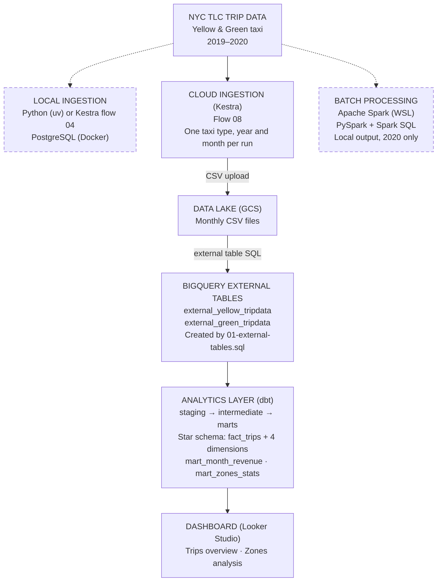

# NYC Taxi Pipeline

End-to-end NYC Taxi data pipeline from monthly CSV ingestion to an analytics dashboard. Kestra uploads CSVs to GCS and merges them into BigQuery tables; BigQuery external tables provide dbt’s sources, dbt builds the marts, and Looker Studio visualizes them. PostgreSQL and Spark are separate learning branches.

> Built following the [Data Engineering Zoomcamp](https://github.com/DataTalksClub/data-engineering-zoomcamp) by DataTalksClub.


## Architecture



The dashed branches do not feed the dashboard.

## Tech Stack
 
| Layer | Technology | Description |
|---|---|---|
| Containerization | Docker + Docker Compose | Runs PostgreSQL, pgAdmin and Kestra as isolated containers |
| Local database | PostgreSQL 18 | Local target to practice containerized, chunked ingestion |
| Orchestration | Kestra | UI-driven workflow engine that automates the loading steps |
| Cloud storage | Google Cloud Storage (GCS) | Data lake storing raw data |
| Data warehouse | BigQuery | Serverless analytical database with external and partitioned tables |
| Analytics engineering | dbt (BigQuery adapter) | SQL-based transformation framework that builds the star schema |
| Batch processing | Apache Spark 4.x + PySpark | Local batch-processing exercises in WSL |
| Visualization | Looker Studio | Interactive dashboard connected directly to BigQuery marts |
| Package manager | uv (Python) | Fast Python package and virtual environment manager |
| Language | Python | Python for ingestion and for batch processing |
 
---

## Configuration

Only `containers/.env.example` is committed. Use it as a reference for the required values, then provide them locally using your preferred setup. Keep local configuration and credentials out of Git.

Set GCP values in the Kestra KV store and add the `GCP_SERVICE_ACCOUNT` secret. Use `nytaxi` for `GCP_DATASET` to match the SQL and dbt sources. dbt also needs a BigQuery profile and the `GCP_PROJECT_ID` environment variable.


## Start the infrastructure

```bash
cd containers
docker compose up -d
```

This starts PostgreSQL, pgAdmin (`http://localhost:8085`), Kestra (`http://localhost:8080`) and Kestra's internal PostgreSQL database.


## Running the pipeline


### Orchestrate with Kestra

Open Kestra at `http://localhost:8080` and run:

| Step | Flow | Purpose |
|---|---|---|
| 1 | `06_gcp_kv` | Set GCP values; change `GCP_DATASET` to `nytaxi` in [`06-gcp-kv.yaml`](orchestration/06-gcp-kv.yaml) to match dbt. |
| 2 | `07_gcp_setup` | Create the GCS bucket and BigQuery dataset. |
| 3 | `08_gcp_taxi` | Load one taxi type, year and month. Repeat for each file needed. |

The last flow uploads a CSV to GCS and merges its rows into the permanent `yellow_tripdata` or `green_tripdata` BigQuery table.


### Data Warehouse

dbt reads the external tables created from CSV files in GCS, not Kestra's permanent `yellow_tripdata` and `green_tripdata` tables. Run `dw/01-external-tables.sql` in the [BigQuery console](https://console.cloud.google.com/bigquery) once the files are in GCS.

The SQL expects the `nytaxi` dataset and CSV files in `data-engineering-demo/yellow` and `data-engineering-demo/green` for 2019–2020. Update the SQL paths if your bucket differs. The external tables reference data in GCS; they do not copy it into BigQuery.

The other `dw/` scripts demonstrate partitioning, clustering and data-quality checks.


### Transform with dbt

dbt uses `external_yellow_tripdata` and `external_green_tripdata` as sources. Set `GCP_PROJECT_ID` and configure the BigQuery profile before running dbt.

From the repository root:

```bash
cd dbt-project
uv sync
cd taxi_rides_ny
uv run dbt deps
uv run dbt debug
uv run dbt seed
uv run dbt run
uv run dbt test
```


### Dashboard
 
The dashboard is built with **Looker Studio** connected directly to the BigQuery marts. No data export needed (Looker Studio queries `mart_month_revenue` and `mart_zones_stats` in real time).

[View the NYC Taxi Analytics Dashboard →](https://datastudio.google.com/s/jHU9jI2t7bo)

---

## Lessons learned

**Resolving a Docker port conflict.**
The host's port 5432 was already used by local PostgreSQL, so the project database maps host port 5433 to container port 5432 (`5433:5432`).  This allows both databases to run at the same time.

**Keeping dbt dependencies separate.**
I used `uv` to run dbt in the project's virtual environment instead of installing it globally. This keeps dbt's dependencies separate from other project tools.

**Running Spark with a compatible Java version.**
Spark 4.x requires Java 17, but my local machine runs a different Java version needed by other projects.
Installing Spark inside WSL solved the conflict cleanly — WSL acts as an isolated Linux layer with its own Java installation, completely independent from the Windows host.

---

## Data source
 
[NY Taxi Record Data](https://github.com/DataTalksClub/nyc-tlc-data/releases) via DataTalksClub GitHub releases:
 
- Yellow taxi: 2019–2020
- Green taxi: 2019–2020
